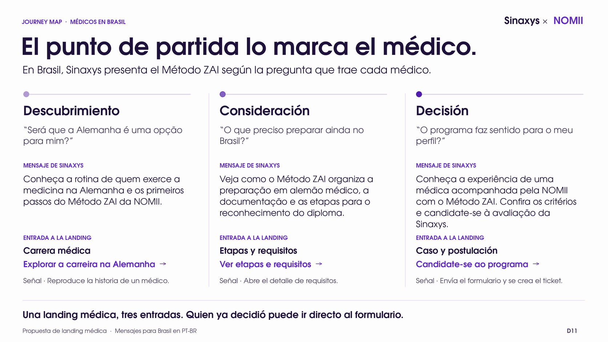

# S23A · El punto de partida lo marca el médico.

<!-- Antetítulo: Journey map · Médicos en Brasil -->

En Brasil, Sinaxys presenta el Método ZAI según la pregunta que trae cada médico.

### Descubrimiento

**Será que a Alemanha é uma opção para mim?**

Conheça a rotina de quem exerce a medicina na Alemanha e os primeiros passos do Método ZAI da NOMII.

**Landing** · Carrera médica.

**CTA** · Explorar a carreira na Alemanha

**Señal** · Reproduce la historia de un médico.

### Consideración

**O que preciso preparar ainda no Brasil?**

Veja como o Método ZAI organiza a preparação em alemão médico, a documentação e as etapas para o reconhecimento do diploma.

**Landing** · Etapas y requisitos.

**CTA** · Ver etapas e requisitos

**Señal** · Abre el detalle de requisitos.

### Decisión

**O programa faz sentido para o meu perfil?**

Conheça a experiência de uma médica acompanhada pela NOMII com o Método ZAI. Confira os critérios e candidate-se à avaliação da Sinaxys.

**Landing** · Caso y postulación.

**CTA** · Candidate-se ao programa

**Señal** · Envía el formulario y se crea el ticket.

> Una landing médica, tres entradas. Quien ya decidió puede ir directo al formulario.

